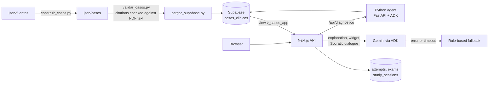

# Razona

ENARM practice app with a Socratic tutor that cites the Mexican Clinical Practice Guidelines (GPC). Built for the AI course at PCIC-UNAM.

Each question is a clinical case written from one GPC. After answering, the student gets the correct option, the guideline page it comes from (with a link to the PDF at that page), the type of mistake they made, and a short Socratic dialogue generated with Gemini. The app also has mock exams, progress tracking and a study mode that compares practice with and without the AI tutor.

Current content: 110 pediatric cases (one index case and one transfer variant for each of 55 guidelines), grouped in 9 areas. All cases are drafts pending medical review.

Educational use only. It does not replace clinical judgment.

## How it works



The server decides and the model only writes text. Grading, case selection (Thompson sampling over per-topic error rates), mistake classification and citations come from the database. Gemini turns that data into an explanation. Without a Gemini key, or when it times out, a fallback built from the case rubric takes over, so the app works end to end with no AI at all.

The correct answer, rubric and key points never reach the browser before the student answers. The case bank tables are not readable with the public key, and every API route validates its input and output with Zod.

## Repository layout

```
app/
  (auth)/login, estudio, restablecer   sign-in, study entry, password reset
  (app)/inicio, practicar, examen,     main app (protected)
        progreso, diagnostico
  api/                                 route handlers (session, attempt, explain, exam, ...)
  recursos/[archivo]                   serves case images from json/assets
lib/
  ai/          tutor engines: ADK + Gemini, fallback, timeouts, widget, Socratic dialogue
  data/        database access with the user's session (RLS)
  learning/    streak, weak topic, Thompson sampling, resource ordering
  schemas/     Zod contracts for content and API
  content/     case catalog read from v_casos_app (cached)
  supabase/    server, proxy and admin clients
components/    UI (shadcn) and app components
json/          case bank: sources, built cases, schema, assets, Python tools
agent/         multi-agent diagnostic exam (Python, Google ADK, FastAPI)
supabase/      migrations, seed and local config
tests/         unit (Vitest) and e2e (Playwright, iPhone viewport)
docs/          ARQUITECTURA.md (technical write-up), DECISIONES.md (decision log)
```

## Requirements

- Node 24 and pnpm
- Docker or Podman (set `DOCKER_HOST` for Podman)
- Supabase CLI
- uv (Python tooling for the case bank and the agent)
- A Gemini API key (optional)

## Setup

```bash
pnpm install
supabase start                 # API at http://127.0.0.1:55321
cp .env.example .env.local     # fill in with the values from `supabase status`
pnpm content:load              # validate and load json/casos into Supabase
pnpm seed:demo                 # demo user with history
pnpm dev --port 3100
```

Set `GOOGLE_GENAI_API_KEY` in `.env.local` to use Gemini. To enable the diagnostic exam, run the agent and set `AGENT_API_URL` and `AGENT_API_TOKEN`:

```bash
cd agent && uv sync
uv run python -m razona_agent.server --port 8080
```

## Scripts

| Command | Description |
|---|---|
| `pnpm verify` | Typecheck, Biome lint and unit tests |
| `pnpm test:e2e` | Playwright end-to-end tests |
| `pnpm content:load` | Validate and load the case bank (idempotent) |
| `pnpm seed:demo` | Reset the demo user |
| `pnpm db:reset` | Reapply migrations and seed |
| `pnpm db:types` | Regenerate `lib/supabase/database.types.ts` |

## Editing content

Cases are edited in `json/fuentes/` and rebuilt with `python3 json/herramientas/construir_casos.py`. New topics go in `json/temas.json`. Then run `pnpm content:load`. No code changes are needed. See [json/README.md](json/README.md) for the case format and validation rules.

## Study mode

`/estudio` creates an anonymous participant with a name and consent, lets them pick the AI or no-AI mode and serves 5 fixed cases. In no-AI mode the app only shows whether the answer was right and the correct option. Results are in the `v_estudio` view, readable only with the service key.

## More

- [docs/ARQUITECTURA.md](docs/ARQUITECTURA.md): architecture, backend flow and implementation details (Spanish)
- [docs/DECISIONES.md](docs/DECISIONES.md): decision log by iteration
- [agent/README.md](agent/README.md): Python agent
