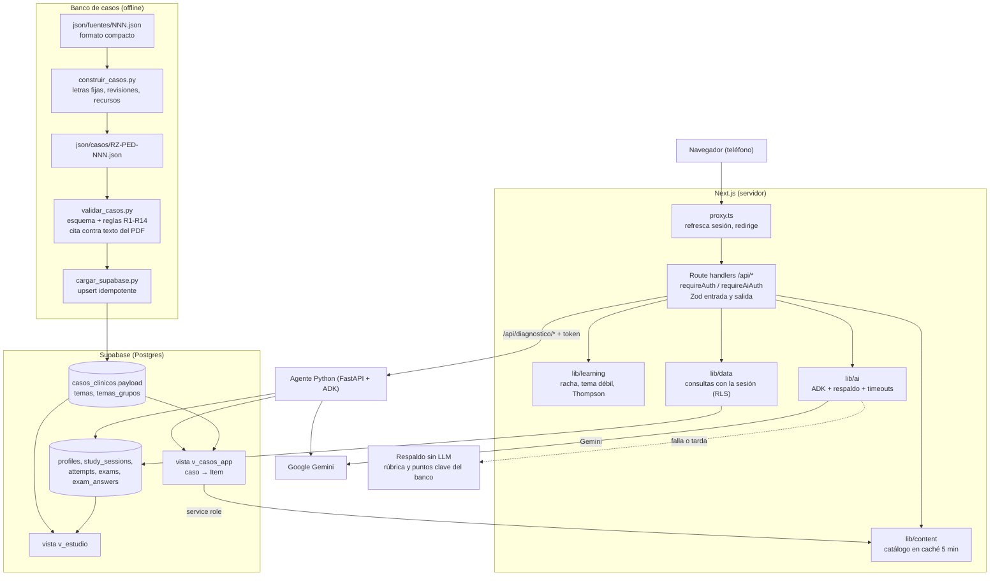
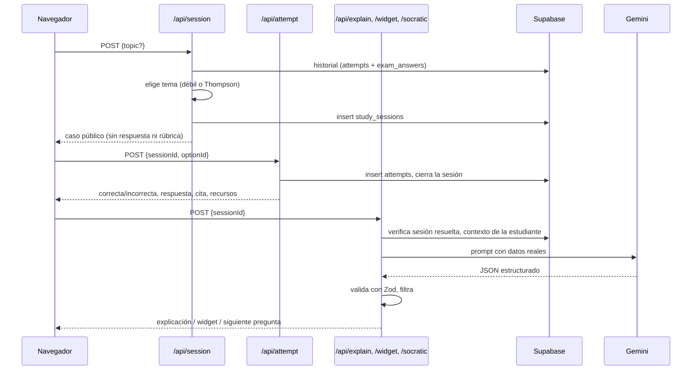

# Razona: arquitectura e implementación

Documento técnico del proyecto. Explica cómo está construido Razona, qué hace cada pieza y por qué se hizo así. Las decisiones puntuales de cada iteración, con fecha, están en [DECISIONES.md](DECISIONES.md); el banco de casos tiene su propio manual en [json/README.md](../json/README.md).

Contenido:

1. [Qué es y qué resuelve](#1-qué-es-y-qué-resuelve)
2. [Componentes](#2-componentes)
3. [Flujo del backend](#3-flujo-del-backend)
4. [Banco de casos clínicos](#4-banco-de-casos-clínicos)
5. [Base de datos](#5-base-de-datos)
6. [Autenticación y control de acceso](#6-autenticación-y-control-de-acceso)
7. [Capa de API](#7-capa-de-api)
8. [Práctica: de elegir el caso a explicarlo](#8-práctica-de-elegir-el-caso-a-explicarlo)
9. [El tutor con IA](#9-el-tutor-con-ia)
10. [Recursos de aprendizaje](#10-recursos-de-aprendizaje)
11. [Examen simulado](#11-examen-simulado)
12. [Progreso, tema débil y Thompson sampling](#12-progreso-tema-débil-y-thompson-sampling)
13. [Agente de diagnóstico en Python](#13-agente-de-diagnóstico-en-python)
14. [Modo estudio (con IA y sin IA)](#14-modo-estudio-con-ia-y-sin-ia)
15. [Pruebas](#15-pruebas)
16. [Despliegue](#16-despliegue)
17. [Limitaciones conocidas](#17-limitaciones-conocidas)

---

## 1. Qué es y qué resuelve

Razona es una aplicación web, pensada primero para el teléfono, para practicar preguntas tipo ENARM. Cada caso clínico está escrito a partir de una Guía de Práctica Clínica (GPC) mexicana del CENETEC/IMSS, y cada afirmación del caso lleva su cita: guía, sección, página y un fragmento literal del PDF.

El problema que ataca es que los bancos de preguntas comunes dicen qué opción era la correcta, pero no por qué te equivocaste ni dónde está escrito. Razona responde tres cosas después de cada pregunta:

- **Qué dice la guía**, con la página exacta y un enlace al PDF en esa página.
- **Por qué te equivocaste**, a partir de una rúbrica que clasifica cada opción incorrecta en un tipo de error (lectura, dato omitido, razonamiento o conocimiento).
- **Si de verdad lo entendiste**, con un diálogo socrático que sube de nivel (recordar, comprender, aplicar, analizar y transferir).

El contenido actual es de pediatría: 110 casos (un caso índice y una variante por cada una de 55 guías), agrupados en 9 áreas.

## 2. Componentes

| Componente | Tecnología | Responsabilidad |
|---|---|---|
| App web | Next.js 16 (App Router), React 19, Tailwind 4, shadcn/ui | Interfaz, rutas de API, lógica de aprendizaje y llamadas al modelo |
| Base de datos y Auth | Supabase (Postgres 17, Auth, RLS) | Usuarias, intentos, exámenes, banco de casos y vistas |
| Modelo de lenguaje | Gemini (`gemini-3.5-flash`) vía Google ADK para TypeScript | Explicación personalizada, widget interactivo y diálogo socrático |
| Agente de diagnóstico | Python, Google ADK, FastAPI | Examen diagnóstico conversacional con varios agentes |
| Banco de casos | JSON + herramientas en Python | Fuente del contenido clínico, validación de citas y carga a Supabase |
| Contratos | Zod 4 | Valida toda entrada y salida de la API y el contenido del banco |

Una regla atraviesa todo el diseño: **el servidor decide y el modelo redacta**. Qué caso sigue, si la respuesta es correcta, qué cita corresponde y qué tipo de error cometió la estudiante se calculan sin IA, con datos de la base. El modelo solo convierte esos datos en una explicación legible. Por eso la app funciona completa sin clave de Gemini (con un tutor de respaldo) y el modelo no puede inventar la cita ni cambiar la calificación.

## 3. Flujo del backend



El orden de una petición típica de práctica es este:



## 4. Banco de casos clínicos

### 4.1 Del JSON compacto al caso completo

Los casos se escriben en `json/fuentes/NNN.json`, un archivo por guía con el caso índice y su variante en un formato corto (citas como `[sección, página, fragmento]`). `construir_casos.py` los expande a `json/casos/RZ-PED-NNN.json`, que es el formato completo que validan el esquema y la base.

Pasos del constructor y por qué importan:

- **Letra correcta fija.** La primera vez que ve un caso, le asigna la letra menos usada y la guarda en `letras.json`. Después nunca cambia. Esto reparte la respuesta correcta por igual entre A y E (sin sesgo hacia una letra) y evita que reconstruir el banco cambie la respuesta de un caso que ya tiene historial en la base.
- **Estado de revisión.** Copia a cada caso el estado de `revisiones.json` (`borrador`, `en_revision`, `revisado_medico`, `retirado`). La revisión médica queda registrada en un solo archivo versionado.
- **Recursos de aprendizaje.** Expande `rec` a `recursos` con id `<caso>-R<n>`.
- **Enlace al PDF.** Copia el `url` de la guía a cada cita como `url_pdf`, y la app abre el PDF en la página citada.
- **Escritura atómica.** Escribe a un `.tmp` y lo renombra, para que un error a medio camino no deje casos a medias.

`--check` confirma que `casos/` está al día con `fuentes/`, y `--solo NNN` reconstruye una sola guía.

### 4.2 Validación

`validar_casos.py` aplica el esquema JSON y reglas propias. Las más importantes:

- **R5: la cita existe.** El fragmento citado debe aparecer en el texto de esa página del PDF (extraído con `pdftotext`). Es lo que impide citas inventadas, el riesgo principal de un contenido médico generado con ayuda de modelos.
- **R3: estado de revisión** coherente con `revisiones.json`.
- **R8 a R11: recursos.** Ids únicos, resaltados que existen literalmente en la viñeta, diagramas Mermaid de 12 nodos como máximo e imágenes con su sha256.
- **R12 a R14 (avisos).** Un recurso que copia la opción correcta o menciona una letra de opción, que el constructor baraja.

Las pruebas del validador están en `json/herramientas/test_validar.py`.

### 4.3 Carga a Supabase

`cargar_supabase.py` (`pnpm content:load`) valida otra vez y hace upsert en orden: grupos, temas, casos índice y variantes. Tres propiedades importan:

- **Idempotente.** Solo escribe lo que cambió; se puede correr cuantas veces sea.
- **Nunca borra.** Un caso que sale del banco queda `retirado`, porque puede tener intentos asociados.
- **Payload tal cual.** El caso se guarda completo en `casos_clinicos.payload` (jsonb). Columnas como `sindrome`, `tipo`, `caso_indice_id` y `estado` son columnas generadas a partir del payload, así que no pueden divergir de él.

### 4.4 Una sola traducción a la app

La vista `v_casos_app` convierte el formato del banco al `Item` que usan la app y el agente: opciones A-E a `a`-`e`, primera cita a `citation` (con `pdfUrl`), rúbrica, puntos clave y recursos (`recursos_app`, que descarta los retirados). Si el formato del banco cambia, se cambia la vista y nada más.

## 5. Base de datos

### 5.1 Tablas

| Tabla | Contenido |
|---|---|
| `profiles` | Una fila por usuaria (la crea un trigger al registrarse): nombre, grupo del estudio, consentimiento |
| `specialties` | Especialidades (seed) |
| `temas_grupos`, `temas` | Áreas y temas del banco |
| `casos_clinicos` | Un caso por fila, payload completo |
| `study_sessions` | Un caso de práctica abierto: qué caso, cuándo se mostró, mensajes del tutor |
| `attempts` | Cada respuesta de práctica: opción, si fue correcta, hora |
| `exams`, `exam_answers` | Exámenes simulados y diagnósticos, y sus respuestas |
| esquema `adk` | Sesiones del agente de Python (privado, no expuesto por la API de datos) |

### 5.2 Seguridad en la base

- **RLS en todas las tablas.** Cada usuaria lee y escribe solo sus filas (`user_id = auth.uid()`). Aunque alguien obtenga la llave pública, no ve datos ajenos.
- **El banco no se expone.** `casos_clinicos`, `temas` y las vistas `v_casos_*` tienen RLS sin políticas y permisos revocados para `anon` y `authenticated`. La rúbrica revela la respuesta por descarte, así que solo el servidor la lee, con la service role.
- **Vistas con `security_invoker`.** Se evalúan con los permisos de quien consulta, no del dueño, y no abren un hueco en RLS.
- **Permisos por columna.** En `profiles` la usuaria solo puede actualizar `display_name`. El grupo del estudio se elige con la función `elegir_grupo_estudio`, `security definer`, que solo acepta la primera elección.

### 5.3 Migraciones

| Migración | Qué hace |
|---|---|
| `20261120100000_init` | Tablas de usuarias, sesiones, intentos y exámenes con RLS |
| `20261121090000_adk_sessions_schema` | Esquema privado `adk` para las sesiones del agente |
| `20261122090000_banco_casos` | Banco de casos, temas, vistas `v_casos_app`, `v_casos_rubrica`, `v_casos_citas` |
| `20261122100000_casos_como_fuente` | Intentos y exámenes apuntan a `casos_clinicos` |
| `20261122110000_recursos_aprendizaje` | `recursos_app` y recursos en `v_casos_app` |
| `20261123090000_gpc_pdf_url` | `pdfUrl` en las citas |
| `20261123110000_grupo_estudio` | `profiles.study_group` y permisos por columna |
| `20261123120000_estudio_participantes` | `study_group_chosen_at`, `elegir_grupo_estudio` |
| `20261123130000_estudio_consentimiento` | `study_consent_at` |
| `20261124090000_vista_estudio` | Vista `v_estudio` para el análisis |

## 6. Autenticación y control de acceso

Hay cuatro formas de entrar: correo y contraseña, Google (opcional), la cuenta demo (Ana) y una sesión anónima para el modo estudio.

La sesión se revisa en tres capas, de lo más barato a lo más seguro:

1. **`proxy.ts`** (el antes llamado middleware) refresca la cookie con `getClaims()` en cada petición y redirige a `/login` si una ruta protegida no tiene sesión. Conserva la ruta en `?next=` para volver después del login; `safeNextPath` solo acepta rutas internas de la app, lo que evita redirecciones abiertas.
2. **El layout de `(app)`** vuelve a verificar con `getUser()`, que consulta a Supabase Auth.
3. **Cada ruta de API** llama a `requireAuth()` y responde 401 sin sesión.

Las participantes del estudio (sesiones anónimas) solo pueden estar en `/practicar` y `/estudio`. El proxy y el layout las devuelven ahí si intentan otra ruta.

Detalles del login: un componente por modo (entrar, crear cuenta, restablecer) para que el estado de un formulario no se mezcle con el otro, reenvío de correo de confirmación, recuperación de contraseña en `/restablecer` y contraseñas de 8 caracteres como mínimo. La contraseña de la cuenta demo solo existe en el servidor.

## 7. Capa de API

Todas las rutas de `app/api` siguen el mismo patrón (`lib/api.ts`):

```ts
const auth = await requireAuth();                       // o requireAiAuth()
const body = await parseJson(request, RequestSchema);    // 400 si no cumple
// ... lógica en lib/data y lib/learning
return ok(ResponseSchema, result);                       // valida también la salida
```

- **Zod en la entrada y en la salida.** Validar la salida evita que un cambio en la base o en el modelo mande al cliente algo que no debía, como la respuesta correcta antes de tiempo.
- **`requireAiAuth`** responde 403 a las cuentas del grupo sin IA del estudio. Lo usan `/api/explain`, `/api/explain/widget`, `/api/explain/socratic`, `/api/tutor` y `/api/diagnostico/*`. El bloqueo vive en el servidor, no solo en la interfaz.
- **`handleError`** traduce los errores conocidos a 400, 401, 403, 404 y 409, y no filtra detalles internos.

| Ruta | Función |
|---|---|
| `POST /api/session` | Elige el siguiente caso y abre una sesión |
| `POST /api/attempt` | Registra la respuesta y revela la correcta |
| `POST /api/explain` | Explicación personalizada |
| `POST /api/explain/widget` | Widget interactivo |
| `POST /api/explain/socratic` | Un turno del diálogo socrático |
| `POST /api/exam/{start,answer,grade}` | Examen simulado |
| `GET /api/progress` | Racha, avance y tema débil |
| `POST /api/diagnostico/*` | Proxy al agente de Python |
| `GET /recursos/[archivo]` | Imágenes de los recursos desde `json/assets` |

## 8. Práctica: de elegir el caso a explicarlo

1. **Elegir el caso** (`/api/session`, `chooseCase`). Si la estudiante pidió su tema débil, se usa ese; si pidió un tema, ese; si no, Thompson sampling (sección 12). La práctica usa solo casos índice; las variantes quedan para el examen y para medir transferencia.
2. **Enviar el caso público.** `toPublicItem` quita la respuesta, la rúbrica y los puntos clave antes de mandar el caso al navegador. Así la respuesta no está en el HTML ni en la red.
3. **Registrar la respuesta** (`/api/attempt`). Se guarda en `attempts` y la sesión se cierra: cada caso se responde una vez. Acierte o no, se revela la respuesta, la cita y los recursos ordenados por su tipo de error.
4. **Explicar.** El cliente pide la explicación, el widget y el diálogo. `loadExplainTarget` comprueba que esa sesión ya esté resuelta y sea de quien la pide (409 si no), así que no se puede pedir la explicación para ver la respuesta antes de contestar.

## 9. El tutor con IA

### 9.1 Contexto real, no inventado

`lib/data/learner.ts` arma el contexto de la estudiante desde la base: nombre, qué opción eligió, su historial en el tema, si es su tema más débil y su racha. El prompt incluye además el caso, la rúbrica de la opción elegida (tipo de error y pregunta semilla) y el fragmento de la GPC. El modelo personaliza con datos que existen.

### 9.2 Salida estructurada

Gemini responde JSON con un esquema (`outputSchema` de ADK), no texto libre. La app lo valida con Zod, recorta lo que no cabe en el teléfono (árbol de 3 niveles y 5 hojas como máximo) y dibuja los diagramas con su propio SVG (`lib/diagram-layout.ts`). La explicación tiene partes fijas: lo que dice la GPC, por qué es la correcta, fundamentos, por qué no aplica cada distractor (primero el que eligió) y el siguiente paso.

### 9.3 Respaldo y tiempos máximos

Cada función tiene un límite de tiempo y una versión sin LLM con el mismo contrato:

| Función | Límite | Respaldo |
|---|---|---|
| Tutor de chat | 6 s (`TUTOR_TIMEOUT_MS`) | Preguntas semilla de la rúbrica |
| Explicación | 16 s | `buildFallbackExplanation`: personalizada con datos reales y un mapa en árbol hecho con campos del caso |
| Diálogo socrático | 12 s | Avanza por las preguntas semilla revisadas por humanos |
| Widget | 35 s | Autoevaluación de puntos clave con la cita y la imagen curada |

`ResilientTutorEngine` hace la carrera entre el modelo y el reloj. ADK se carga con `import()` dinámico: si el módulo falla al cargar, también cae al respaldo. Para la estudiante ambas versiones se ven iguales.

### 9.4 Salvaguardas

- **No revelar antes de tiempo.** En el tutor previo a responder, si el texto del modelo contiene la opción correcta o frases como "la respuesta correcta es", se descarta y se usa el respaldo.
- **Citas deterministas.** La cita mostrada sale del caso, no del texto del modelo, así que siempre existe y es la correcta.
- **Fuentes limitadas.** El prompt prohíbe citar fuentes distintas de la GPC del caso; las cifras y dosis solo pueden venir del caso o de la guía.
- **Texto plano.** `lib/text.ts` limpia el Markdown que el modelo a veces agrega.

### 9.5 Widget interactivo

El modelo genera HTML, CSS y JS que se ejecuta en un `iframe` con `sandbox="allow-scripts"` (sin same-origin) y una CSP sin red. El widget no puede leer cookies ni hacer peticiones. Las imágenes se resuelven en el servidor y viajan como `data:`, en este orden: imagen curada del banco, Wikimedia Commons con licencia libre y, al final, una ilustración generada con Gemini rotulada como tal.

### 9.6 Diálogo socrático

`/api/explain/socratic` no guarda estado: el cliente manda la conversación y el nivel, y el servidor vuelve a validar el caso en cada turno. La escalera es recordar, comprender, aplicar, analizar y transferir. Si la respuesta no muestra comprensión, se queda en el mismo nivel con una pista. Si se equivocó, los primeros niveles corrigen esa idea; si acertó, la llevan a una variante.

## 10. Recursos de aprendizaje

Cada caso índice trae flashcards, un diagrama Mermaid, resaltados de la viñeta, a veces una tabla y hasta dos imágenes, y cada recurso declara para qué tipos de error sirve (`para_errores`). Después de responder, `errorTypesFor` obtiene el tipo de error de la opción elegida desde la rúbrica y `orderResources` pone primero los recursos que atienden ese error. Si confundió un dato de la viñeta, ve primero el resaltado; si le faltó conocimiento, la flashcard.

Las imágenes se sirven desde `json/assets` en `/recursos/<archivo>` (con validación del nombre de archivo), sin copiarlas a `public/`, y se incluyen en el build de Vercel con `outputFileTracingIncludes`.

## 11. Examen simulado

Tres alcances: global (10 reactivos repartidos entre áreas), por área (hasta 10) o por tema (índice y variante). El orden es determinista para una misma semilla. `exams` guarda el alcance y la lista de reactivos, y `exam_answers` cada respuesta (upsert, se puede cambiar hasta calificar). Al calificar, lo no respondido cuenta como incorrecto. En resultados, cada reactivo fallado muestra el tipo de error de la rúbrica, su explicación y la cita, y los recursos de aprendizaje.

## 12. Progreso, tema débil y Thompson sampling

Las métricas usan intentos de práctica y respuestas de exámenes terminados.

- **Racha** en zona horaria `America/Mexico_City`. Si hoy no hay actividad, sigue viva contando desde ayer.
- **Dominio por tema**: media posterior de una Beta, (aciertos + 1) / (total + 2). El +1/+2 evita que una sola respuesta dé 0 % o 100 %.
- **Tema débil**: el de menor dominio entre los temas con 3 respuestas o más.
- **Siguiente caso por Thompson sampling.** Por cada tema se toma una muestra de Beta(1 + errores, 1 + aciertos), que representa la probabilidad de fallar, y se elige el tema con la muestra más alta. El tema débil sale casi siempre, pero los temas con pocos datos tienen varianza alta y también salen a veces. Es el equilibrio entre explotar lo que se sabe y explorar lo que no se ha medido.
- **Semilla determinista** (`hash(userId:nRespuestas)` + mulberry32): la misma historia da la misma elección, lo que hace las pruebas y la demo reproducibles. El agente de Python usa la misma semilla y el mismo PRNG.

Toda esta lógica es pura (`lib/learning/*`) y tiene pruebas unitarias.

## 13. Agente de diagnóstico en Python

`agent/` es un sistema multiagente con Google ADK para Python:

```
coordinador
├── agente_diagnostico   arma, aplica y califica el examen diagnóstico
├── agente_preparacion   progreso, tema débil, plan de estudio
└── tutor_socratico      caso, GPC, registro de intentos
```

La app web lo llama desde `/api/diagnostico/*` en el servidor, nunca desde el navegador: el token (`AGENT_API_TOKEN`) y la URL son de servidor y el `user_id` sale de la sesión de Supabase, no del modelo. Las herramientas del agente leen el id de la estudiante del estado de la sesión, así que el LLM no puede actuar en nombre de otra.

El flujo es híbrido: crear, responder y calificar son funciones deterministas; el agente solo narra. Un callback (`answer_guardrail`) reemplaza cualquier respuesta que revele la opción correcta de un reactivo abierto. El diagnóstico se guarda en `exams` con `exam_key = 'diagnostico-adk'`, así que alimenta el mismo progreso que la app. En Vercel las sesiones de ADK se guardan en Postgres (esquema `adk`), porque dos peticiones del mismo diagnóstico pueden llegar a instancias distintas.

## 14. Modo estudio (con IA y sin IA)

Se construyó para comparar el desempeño practicando con y sin el tutor, desde el mismo servidor.

- **Entrada.** El botón "Participar en el estudio" del login lleva a `/estudio`. Ahí la persona escribe su nombre y acepta un acuerdo breve que describe exactamente lo que se guarda. Se crea una sesión anónima de Supabase (sin correo ni contraseña) y el trigger guarda nombre y fecha de consentimiento.
- **Modo.** Elige con IA o sin IA; `elegir_grupo_estudio` guarda solo la primera elección.
- **Preguntas fijas.** `/api/session` entrega a las participantes los 5 casos de `lib/study.ts` en orden y responde 409 al terminar. `getStudyProgress` calcula el avance desde `attempts`.
- **Sin IA** solo dice si acertó y, si no, cuál era la correcta: sin explicación, cita, recursos ni tutor. El servidor tampoco los envía y las rutas de IA responden 403.
- **Fin.** `/estudio/fin` agradece; el botón de salida cierra la sesión anónima y deja el teléfono listo para otra persona.
- **Análisis.** La vista `v_estudio` da una fila por respuesta (participante, modo, caso, tema, opción, si fue correcta, segundos entre mostrar y responder). Solo la lee el equipo desde el editor SQL o con la llave secreta.

Lección del primer levantamiento: con IA 46 % y sin IA 44 % de aciertos, sin diferencia. El diseño no podía mostrar un efecto: la respuesta se registra antes de cualquier retroalimentación y las 5 preguntas son de temas distintos, así que lo que explica el tutor en una no se vuelve a evaluar. Un diseño útil usa pares índice y variante del mismo tema (el banco ya los tiene) y mide la variante después de la retroalimentación.

## 15. Pruebas

| Comando | Qué cubre |
|---|---|
| `pnpm verify` | `next typegen` + `tsc`, Biome y Vitest |
| `pnpm test:e2e` | Playwright con viewport de iPhone 15: guion demo, login, grupo control, estudio, diagnóstico |
| `cd json && python3 -m pytest herramientas -q` | Constructor y validador del banco |
| `cd agent && uv run pytest` | Agente de Python (sin llamar a Gemini) |

Las pruebas unitarias cubren la lógica pura (racha, Thompson, tema débil, orden de recursos, rutas seguras), los contratos de contenido, que las tablas del banco y `v_estudio` no sean legibles con la llave pública, y que el tutor de respaldo no revele la respuesta. Las e2e corren contra Supabase local con el banco cargado.

## 16. Despliegue

- **Web**: proyecto de Vercel `razona`, desplegado con la CLI (`vercel deploy --prod`).
- **Agente**: proyecto de Vercel `razona-agent` con raíz `agent/` (FastAPI por `agent/index.py`).
- **Base**: proyecto de Supabase en us-east-1, junto a la región de Vercel para reducir latencia.

Orden: migraciones (`supabase db push`), carga del banco (`pnpm content:load:prod`), agente y luego la app web. Las variables de producción viven en archivos `.env*.local` ignorados por git.

## 17. Limitaciones conocidas

- **Casos en borrador.** Los 110 casos necesitan revisión de un médico; el flujo para registrarla existe (`revisiones.json`).
- **Carrera en el examen.** La interfaz cuenta una respuesta como guardada antes de que el servidor confirme; si la red falla en ese momento, esa respuesta puede perderse.
- **Código sin uso.** `/api/tutor` (chat antes de responder) y la tabla `items` quedan del diseño anterior.
- **Estudio actual.** Ver la sección 14: el diseño de 5 preguntas mide conocimiento previo, no el efecto del tutor.
- **Pediatría solamente.** Agregar otra especialidad requiere contenido nuevo, no código: fuentes, `temas.json` y el seed de especialidades.
